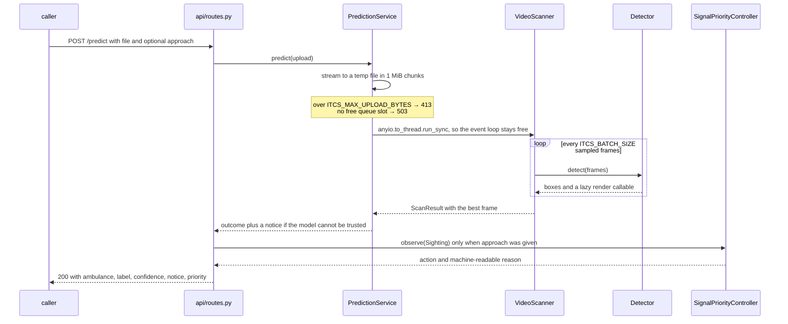
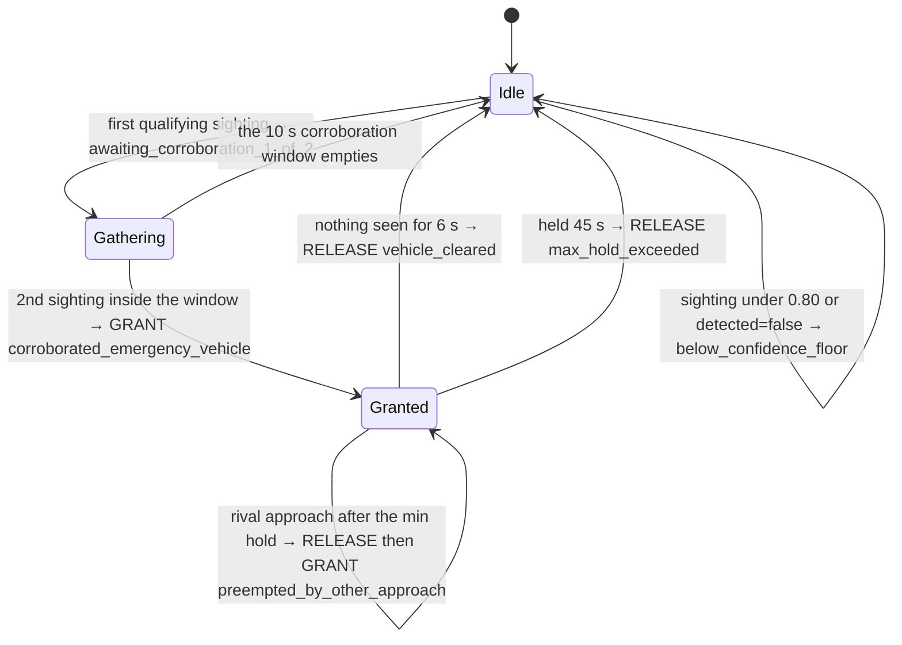

# Intelligent Traffic Control System (ITCS)

A FastAPI service that scans an uploaded traffic clip for an emergency vehicle with a YOLO
model, then feeds what it found into a signal-priority **decision layer** — a pure state
machine that says whether an intersection should grant, hold or release an emergency phase.

It emits decisions and nothing else. There is no signal-hardware integration, no traffic-light
automation and no user interface here: the HTTP API and its OpenAPI docs are the entire surface,
and everything below is about code that is in this repository.

## Run it from a clean clone

```bash
cd smart-traffic-backend
python -m venv .venv && source .venv/bin/activate
pip install -r requirements-ml.txt          # service + the YOLO/torch stack
uvicorn app.main:app --port 8250            # docs at http://localhost:8250/docs
```

No checkpoint ships here and you still get real inference: `ITCS_DETECTOR` defaults to `auto`, which
uses `weights/best.pt` if you have one and otherwise downloads the public `yolov8n.pt` (6,549,796
bytes) from the Ultralytics release assets into `ITCS_MODEL_CACHE_DIR` on first use. The committed
cold start in [`docs/service-boot.log`](docs/service-boot.log) reaches `Application startup
complete` 5.5 s after process start, download included. Then, against a bundled 4096x2160 clip:

```console
$ curl -s -F "file=@../test_files/ambulance_video1.mp4" -F "approach=north" \
    localhost:8250/predict | jq '{ambulance, label, confidence, frames_read, frames_inferred}'
{ "ambulance": true, "label": "bus", "confidence": 0.7709326148033142, "frames_read": 70, "frames_inferred": 22 }
```

`scripts/demo.sh` drives that end to end plus a priority grant and a denial; full transcripts are
in [`docs/predict-session.md`](docs/predict-session.md) and
[`docs/priority-session.md`](docs/priority-session.md).

## Why the fallback answers `"bus"`

That `label: "bus"` is the interesting part, not a bug. COCO has no ambulance class, so the fallback
*cannot* identify an ambulance — and the service is built so it cannot pretend otherwise. The
`Detector` protocol carries two capability flags, `performs_real_detection` and
`identifies_ambulances`; `/health` publishes them verbatim (the fallback reports
`identifies_ambulances: false`); and every `/predict` response from such a model carries a `notice`
saying the label is not a confirmed ambulance, while one that *can* identify an ambulance carries
none (`test_a_model_without_an_ambulance_class_says_so`, `test_a_real_ambulance_model_carries_no_notice`).
`ITCS_COCO_EMERGENCY_CLASSES` (`truck,bus`) names the labels treated as *candidate* emergency
vehicles — no accuracy is claimed for it.

Three detectors are registered: `yolo` (your own single-class YOLOv8 ambulance checkpoint at
`weights/best.pt`, class id `0`, never committed here — the only one that answers yes to
"identifies ambulances"), `coco` (the auto-downloaded public checkpoint, also pre-fetched into
the Docker image) and `stub` (loads nothing, reads no pixels). Asking for `ITCS_DETECTOR=yolo`
with no weights on disk fails with a message naming the path and the three ways to fix it.

## Faking a detection takes two deliberate opt-ins

The only route to a fabricated result is the `stub` detector, and one forgotten variable does not
get you there: it must be named explicitly — `auto` never resolves to it
(`test_auto_never_selects_the_fake_detector`) — *and* `ITCS_ENV` must be `development` or `test`.
`ITCS_ENV` defaults to **`production`**, where `Settings.validate()` refuses the configuration and
the process does not start (`test_refused_in_the_default_environment`,
`test_refused_in_an_explicit_production_environment`, `test_refused_in_staging`). So
`ITCS_DETECTOR=stub ITCS_ENV=development uvicorn app.main:app` is the whole incantation, and it is
loud: a `CRITICAL` startup banner, `performs_real_detection: false` on `/health`, a fabrication
notice on every response. A test also pins that an upload's *filename* can never on its own
produce a detection (`test_filename_alone_never_produces_a_detection`).

## What a `/predict` call actually does



Three steps are load-bearing. The upload never sits in the event loop's memory — spooled to disk
in chunks, refused with 413 past `ITCS_MAX_UPLOAD_BYTES`. The blocking scan runs on a worker
thread bounded by `ITCS_MAX_CONCURRENT_INFERENCES` (running) and `ITCS_INFERENCE_QUEUE_SLOTS`
(waiting), with a fast 503 beyond. Rendering is lazy, so a 100-frame scan annotates exactly one
frame — and `frames_read: 70, frames_inferred: 22` above is `ITCS_FRAME_STRIDE` at work, the scan
exiting once it has `ITCS_MIN_FRAMES_WITH_AMBULANCE` frames of evidence.

**The returned frame is capped on purpose**, being the largest thing in the payload by an order
of magnitude. Off the 4096x2160 clip at OpenCV's default quality 95 with no resize, the
`/predict` body measures **1,757,211 bytes**; the shipped defaults — 1280 px longest edge at
quality 85 — bring the same request to **157,527 bytes**, about **11x smaller**, with no change
to the detection result. Both figures are captured in
[`docs/predict-session.md`](docs/predict-session.md), both ends stay reachable via
`ITCS_MAX_FRAME_EDGE` and `ITCS_JPEG_QUALITY`, and the same ratio (11.3x) falls out of
`app.imaging.encode_frame` on a raw frame of that clip. `ITCS_RETURN_FRAME=false` drops it.

## Deciding what a signal should do

Detecting an ambulance is half of "traffic control"; deciding what a signal *should* do about noisy
evidence is the other half, and `app/priority/` is that half. `SignalPriorityController` is a pure,
deterministic state machine with an injected clock, no I/O and **no hardware of any kind behind
it**. It returns `PriorityDecision` values — acting on them would be the signal owner's job, and
this repository contains no such owner.



`controller.py` documents six rules — the two timeout releases below count as one there — and
every one of them has a test, 19 in `tests/test_priority_controller.py`:

| Rule | Why | Default |
| --- | --- | --- |
| Confidence floor | One confused frame is not evidence | `0.80` |
| Corroboration: N sightings in T seconds | Neither is one confident frame | `2` in `10.0 s` |
| Minimum hold | The phase must not flap | `8.0 s` |
| Preemption only after that hold | A waiting ambulance outranks the tail of a phase | — |
| Release once the vehicle has cleared | Give the intersection back | `6.0 s` |
| Hard `max_hold` ceiling | A stuck or spoofed detector cannot hold a junction open forever (`test_a_stuck_detector_cannot_hold_the_junction_forever`) | `45.0 s` |
| Per-approach cooldown after release | A queue of vehicles must not re-trigger the phase | `20.0 s` |

The `reason` strings on the arrows are the literal values the API returns. Three endpoints drive
the layer without going through `/predict`: `POST /priority/sightings` takes one report from a
caller running its own detector, `GET /priority/state` reports the phase after applying pending
timeouts, and `POST /priority/tick` advances the clock without new evidence, needed because the
clock only moves when a request arrives. With `/health` that is the whole API.

## Configuration, layers and tests

Every knob is an `ITCS_*` environment variable read once into a frozen `Settings` dataclass, and
`Settings.from_env()` is the only reader of `os.environ` anywhere — which is why a test builds a
bespoke configuration without touching the environment. Invalid values fail at startup rather than
degrading silently. **`app/config.py` is the authoritative list**: one field per variable, default
inline; `docker-compose.yml` shows a realistic subset in use.

The package is layered outermost-in: `api` (routes, schemas, dependencies) → `services`
(`prediction.py` — spooling, size cap, thread offload, concurrency) → `detection` (`base.py` the
port, `registry.py` the name→factory map, `yolo.py`/`stub.py` the adapters, `scanner.py` the
OpenCV pipeline) and `priority` (`controller.py`, `models.py`) → `config.py`. **Nothing below
`api` imports FastAPI**, which is what makes the pipeline and the state machine testable as
plain objects.

From `smart-traffic-backend`, `pip install -r requirements-dev.txt` (no torch) then `python -m pytest`
gives **150 passed**; `ruff check .` and `ruff format --check .` are clean across 33 files. No camera,
video file, weights or torch install is needed: `ultralytics` is imported inside
`_YoloDetector.warmup()`, and `test_ultralytics_is_not_imported_at_module_load` fails if that regresses. An autouse fixture strips ambient `ITCS_*` variables so a developer's shell
cannot steer results. Adding a detector backend is one module plus one `@register("name")`
decorator, which `test_a_new_backend_needs_only_a_registry_entry` proves by registering one at
test time. `requirements-ml.txt` pins `ultralytics==8.3.200`; earlier 8.3.x releases carry a
`numpy<2.0.0; sys_platform == "darwin"` marker unsatisfiable alongside this project's
`numpy==2.1.3`, so they resolve on Linux and fail on macOS.

## Docker

`Dockerfile` and `docker-compose.yml` are here — three stages (CPU-only dependency build,
public-checkpoint pre-fetch, slim runtime), a non-root `itcs` user at uid 10001, a `curl` healthcheck
on `/health` with a 90 s start period, host port 8250. **They are unproven.** This
project's uplift report records `Build verified: NOT RUN — deferred, RAM constraint` and `Boot
verified: NOT RUN — deferred, RAM constraint`; the only Docker command ever run here was
`docker compose config`, which parsed OK. Treat `docker compose up --build` as untested and use
the local path above for a service that is known to start.

## What this does not do

- **No signal control, scheduling or hardware integration.** The priority layer emits decisions;
  nothing here acts on them. **No frontend** either — the API and `/docs` are the whole surface.
- **No accuracy figures.** The trained weights are not distributed here and the public fallback
  is not an ambulance classifier, so any number would be meaningless.
- **In-memory, single-instance controller.** Not shared across replicas, not durable across
  restarts. Distributing it means putting the state behind a compare-and-set store; the state
  machine is already pure and would not change.
- **Not a stream processor.** One request, one uploaded file, only the frames the budget allows
  — no RTSP ingest, no tracking beyond the sightings you send. **Timeouts need driving**, and
  **uploads are unauthenticated**: size- and concurrency-capped, but no auth, no rate limiting.

## License

No license file is included, so all rights are reserved by default. Add a `LICENSE` before distributing.
