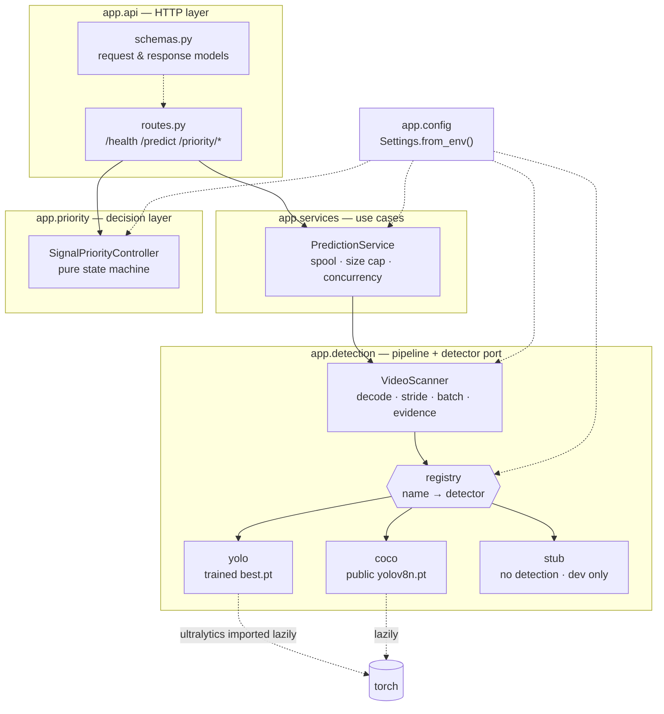
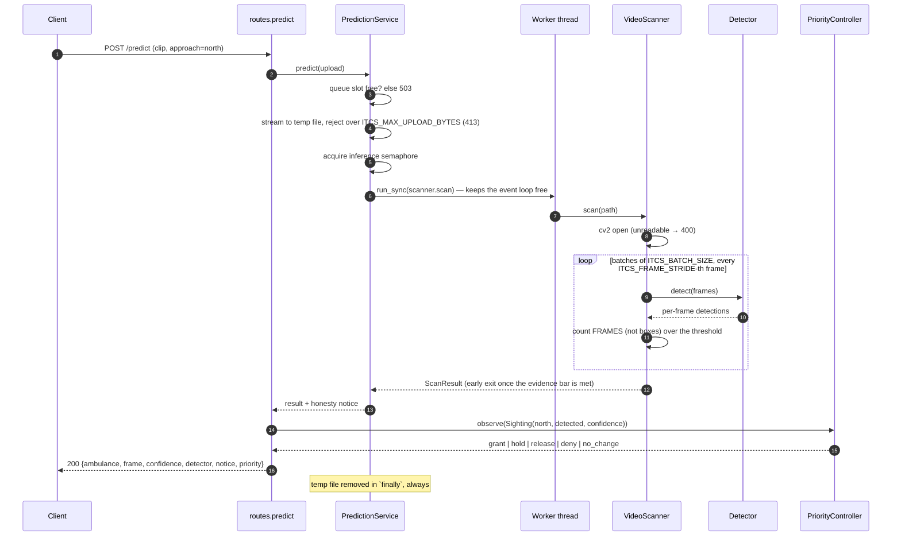

# Intelligent Traffic Control System (ITCS)

A FastAPI service that scans an uploaded traffic clip for an emergency vehicle
with a YOLO model, and feeds what it finds into a **signal-priority decision
layer** — a tested state machine that decides whether an intersection should be
asked to grant, hold or release an emergency phase.

It is a decision component. It talks to no signal hardware, drives no
controller, and ships no user interface. Everything below is true of the code
in this repository.

---

## Captured output

Everything in this section was captured on 2026-09-23 from the service running
locally on `http://localhost:8250`, with the settings `docker-compose.yml`
ships. Full transcripts are in [`docs/`](docs/): [service
boot](docs/service-boot.log), [detection](docs/predict-session.md),
[priority](docs/priority-session.md).

No ambulance weights were on disk, so `ITCS_DETECTOR=auto` chose the public
COCO fallback and downloaded it itself. That is the out-of-the-box experience.

### A cold start on a machine with no weights and no model cache

```
2026-09-23 18:57:15,872 WARNING  app.detection.registry: ITCS_DETECTOR=auto -> 'coco': no ambulance weights at /srv/itcs/weights/best.pt, falling back to the public yolov8n.pt checkpoint. It detects generic COCO vehicle classes and CANNOT identify an ambulance.
2026-09-23 18:57:15,872 INFO     app.detection.weights: Downloading public checkpoint https://github.com/ultralytics/assets/releases/download/v8.3.0/yolov8n.pt -> /srv/itcs/weights/yolov8n.pt
2026-09-23 18:57:20,563 INFO     app.detection.weights: Downloaded /srv/itcs/weights/yolov8n.pt (6549796 bytes).
2026-09-23 18:57:21,342 INFO     app.detection.yolo: Loading YOLO weights from /srv/itcs/weights/yolov8n.pt ...
2026-09-23 18:57:21,359 INFO     app.detection.yolo: Detector 'coco' ready (device=auto, classes={0: 'person', 1: 'bicycle', 2: 'car', ...}).
2026-09-23 18:57:21,359 INFO     app.main: ITCS 1.0.0 ready: detector=coco real=True ambulance_class=False env=production
INFO:     Application startup complete.
INFO:     Uvicorn running on http://127.0.0.1:8250 (Press CTRL+C to quit)
```

Five and a half seconds from process start to serving real inference — with no
weights file of your own, no model in the repository and no manual step.

### `GET /health` — the service states what its model can actually do

```console
$ curl -s http://localhost:8250/health | jq
{
  "status": "ok",
  "version": "1.0.0",
  "environment": "production",
  "detector": {
    "name": "coco",
    "performs_real_detection": true,
    "identifies_ambulances": false,
    "description": "Public Ultralytics yolov8n.pt (COCO). COCO has no ambulance class; truck, bus are treated as candidate emergency vehicles."
  },
  "inference_slots_free": 8
}
```

### `POST /predict` — a real scan of a real 4K clip

```console
$ curl -s -F "file=@test_files/ambulance_video1.mp4" -F "approach=north" \
    http://localhost:8250/predict | jq
{
  "ambulance": true,
  "frame": "<base64 JPEG, 157168 chars>",
  "confidence": 0.7709326148033142,
  "label": "bus",
  "frames_read": 70,
  "frames_inferred": 22,
  "detector": "coco",
  "notice": "The active model has no ambulance class: it reports generic vehicle classes and cannot confirm that the vehicle is an ambulance. Load the purpose-trained weights (ITCS_WEIGHTS_PATH) for a real answer.",
  "priority": {
    "action": "no_change",
    "approach": "north",
    "reason": "below_confidence_floor",
    "held_for_s": null,
    "state": {
      "priority_active": false,
      "active_approach": null,
      "held_for_s": null,
      "cooldowns": {}
    }
  }
}
```

Two things are worth reading closely. The `notice` is the point of the
`identifies_ambulances` flag: the active model is a public COCO checkpoint, so
the service says out loud that `label: "bus"` is **not** a confirmed ambulance.
And `priority.reason` is `below_confidence_floor` — 0.771 is under the
controller's 0.80 floor, so the sighting is not evidence. Detection and
priority are held to separate bars on purpose.

`frames_read: 70, frames_inferred: 22` is the stride at work: 22 forward passes
covered 70 frames of video, and the scan stopped early once it had the evidence
it needed.

### The priority layer granting a phase

One sighting is never enough; the second one inside the window is.

```console
$ SIGHT='{"approach":"north","confidence":0.95}'
$ curl -s -H "Content-Type: application/json" -d "$SIGHT" \
    http://localhost:8250/priority/sightings | jq
{
  "action": "no_change",
  "approach": "north",
  "reason": "awaiting_corroboration_1_of_2",
  "held_for_s": null,
  "state": { "priority_active": false, "active_approach": null, "cooldowns": {} }
}

$ # the same request again
{
  "action": "grant",
  "approach": "north",
  "reason": "corroborated_emergency_vehicle",
  "held_for_s": 0.0,
  "state": {
    "priority_active": true,
    "active_approach": "north",
    "held_for_s": 0.0,
    "cooldowns": {}
  }
}

$ # a competing approach, while north is still inside its 8s minimum hold
{
  "action": "deny",
  "approach": "east",
  "reason": "conflicting_approach_within_min_hold",
  "held_for_s": 0.04088300000876188,
  "state": { "priority_active": true, "active_approach": "north", "cooldowns": {} }
}
```

### Six simultaneous uploads

`ITCS_MAX_CONCURRENT_INFERENCES=2`, so the six requests complete in three pairs
instead of contending for the same cores. Nothing is dropped — 503 only starts
past `ITCS_INFERENCE_QUEUE_SLOTS`.

```console
$ for i in $(seq 1 6); do
>   curl -s -o /dev/null -w "%{http_code}  %{time_total}s\n" \
>     -F "file=@test_files/ambulance_video1.mp4" http://localhost:8250/predict &
> done; wait
200  1.837622s
200  2.023958s
200  3.577318s
200  3.783004s
200  5.429247s
200  5.599744s
```

### The service refusing to do the wrong thing

```console
$ ITCS_DETECTOR=yolo uvicorn app.main:app        # no weights on disk
DetectorUnavailableError:
Ambulance weights not found at /srv/itcs/weights/best.pt.
These weights are trained per-deployment and are deliberately NOT committed to this repository.
Options:
  1. Train or obtain a single-class YOLOv8 ambulance checkpoint and place it at /srv/itcs/weights/best.pt (or point ITCS_WEIGHTS_PATH at it).
  2. Run with ITCS_DETECTOR=coco to use the auto-downloaded public YOLOv8n checkpoint. It detects generic COCO vehicle classes only and cannot identify an ambulance.
  3. Leave ITCS_DETECTOR=auto, which picks option 2 for you.

$ ITCS_DETECTOR=stub uvicorn app.main:app        # ITCS_ENV defaults to production
ConfigurationError:
ITCS_DETECTOR=stub performs NO detection and is refused while ITCS_ENV='production'. Set ITCS_ENV=development (or 'test') as a second, deliberate opt-in if you really want the fake detector.
```


---

## Architecture

The pattern is **ports and adapters** (hexagonal): the detector is a port with
three adapters behind a registry, and every layer depends only on the ones
below it. Nothing under `app/api` imports FastAPI, which is exactly what makes
the pipeline and the decision layer testable on their own.



## Request flow



---

## Quickstart

### Docker (recommended)

```bash
docker compose up -d --build     # API on http://localhost:8250
./scripts/demo.sh                # health + a real detection + a priority grant
```

The image bakes in the public `yolov8n.pt` checkpoint at build time, so the
container starts and serves **real inference with no manual step and no weights
file of your own**. `docker compose down -v` tears it all down.

To run the purpose-trained ambulance model instead, mount it at
`/app/weights/best.pt`. Add one line to the `api` service's `volumes:` in
`docker-compose.yml`:

```yaml
    volumes:
      - model-cache:/app/weights
      - /absolute/path/to/best.pt:/app/weights/best.pt:ro   # <- add this
```

`ITCS_DETECTOR=auto` (the default) then sees the file and selects the `yolo`
detector automatically. Nothing else changes.

### Model weights — read this before filing a bug

`/predict` needs a checkpoint, and there are three ways to get one:

| Detector | Checkpoint | Where it comes from | Can it identify an ambulance? |
| --- | --- | --- | --- |
| `yolo` | `weights/best.pt` | **You supply it.** A single-class YOLOv8 model trained on ambulances, class id `0`. Deliberately not committed — see below. | Yes |
| `coco` | `yolov8n.pt` (~6 MB) | Downloaded automatically from the public Ultralytics release assets on first use, and pre-fetched into the Docker image at build time. | **No** — see below |
| `stub` | none | Nothing is loaded and no pixels are read. Development and test only. | No |

`ITCS_DETECTOR=auto` picks `yolo` when `weights/best.pt` exists and `coco`
otherwise. **It never picks `stub`.**

The trained weights are not in this repository on purpose: they are a large
binary that belongs to a deployment rather than to source control, and the
model that ships with a portfolio project should not be mistaken for a
validated one. When they are missing, the service does not crash with a stack
trace — it falls back to the public checkpoint and tells you so, and if you ask
for `ITCS_DETECTOR=yolo` explicitly it refuses to start with a message naming
the path it looked at and the three options above.

**What the `coco` fallback really is.** COCO has no ambulance class. The
fallback treats the COCO labels in `ITCS_COCO_EMERGENCY_CLASSES` (`truck,bus`
by default) as *candidate* emergency vehicles so the pipeline is genuinely
exercised end to end on real pixels. It cannot tell an ambulance from a
delivery lorry, it reports `identifies_ambulances: false` on `/health`, and it
attaches a `notice` to every single prediction. No accuracy is claimed for it.

### The kill switch, and why you cannot leave it on

The earlier version of this service had two environment variables that faked
detections — including one that reported an ambulance because the *uploaded
filename* contained the word. Both are gone. The only way to get a fabricated
result is the `stub` detector, and it needs **two independent, deliberate
opt-ins**:

```bash
ITCS_DETECTOR=stub ITCS_ENV=development uvicorn app.main:app
```

`ITCS_ENV` defaults to `production`, in which `ITCS_DETECTOR=stub` makes the
process **refuse to start**. If it does start, the fake is impossible to miss:
a `CRITICAL` banner in the startup log, `performs_real_detection: false` on
`/health`, and a `notice` on every prediction saying the result was fabricated.

### Local, without Docker

```bash
cd smart-traffic-backend
python -m venv .venv && source .venv/bin/activate
pip install -r requirements-ml.txt          # runtime + the YOLO stack
uvicorn app.main:app --reload --port 8250
```

Interactive docs at `http://localhost:8250/docs`.

---

## API

| Method | Path | What it does |
| --- | --- | --- |
| `GET` | `/health` | Liveness, plus an honest statement of what the loaded model can do. |
| `POST` | `/predict` | Multipart `file` (a clip) and optional `approach`. Scans the clip; when `approach` is given the result is fed to the priority controller and its decision is returned. |
| `POST` | `/priority/sightings` | Feed one detection report in directly, for a caller running its own detector. |
| `GET` | `/priority/state` | Current phase, after applying pending timeouts. |
| `POST` | `/priority/tick` | Advance the controller's clock without new evidence — how the timeout rules fire in a request/response world. |

`POST /predict` status codes:

| Status | When |
| --- | --- |
| 200 | Scanned. `ambulance` is the answer; check `notice` before trusting it. |
| 400 | OpenCV could not open the upload as a video. |
| 413 | Upload exceeded `ITCS_MAX_UPLOAD_BYTES`. |
| 422 | No `file` field. |
| 503 | All inference slots are taken; retry shortly. |
| 500 | Anything else. Details are logged, never returned. |

Which container formats work (MP4, AVI, MOV, …) depends on the codecs your
OpenCV build was compiled against.

---

## Configuration

Every setting is an environment variable, parsed once into an immutable
`Settings` object at startup. Nothing else in the codebase reads `os.environ`.

### Environment and detector

| Variable | Required | Default | What it does |
| --- | --- | --- | --- |
| `ITCS_ENV` | no | `production` | `production`, `development` or `test`. The fake `stub` detector is refused unless this is `development` or `test`. |
| `ITCS_DETECTOR` | no | `auto` | `auto`, `yolo`, `coco` or `stub`. `auto` = `yolo` if the weights file exists, else `coco`. Never `stub`. |
| `ITCS_WEIGHTS_PATH` | no | `<backend>/weights/best.pt` | The purpose-trained ambulance checkpoint. |
| `ITCS_PUBLIC_MODEL` | no | `yolov8n.pt` | Public checkpoint used by the `coco` detector. |
| `ITCS_MODEL_CACHE_DIR` | no | `<backend>/weights` | Where the public checkpoint is cached. Pre-seeded in the Docker image. |
| `ITCS_COCO_EMERGENCY_CLASSES` | no | `truck,bus` | COCO labels the fallback treats as candidate emergency vehicles. |

### Detection tuning

| Variable | Required | Default | What it does |
| --- | --- | --- | --- |
| `ITCS_CONFIDENCE_THRESHOLD` | no | `0.75` | Minimum confidence (0–1) for a box to count. |
| `ITCS_MIN_FRAMES_WITH_AMBULANCE` | no | `1` | Frames of evidence before a positive result. Frames, not boxes. |
| `ITCS_MAX_FRAMES` | no | `100` | Hard budget of frames inferred per upload. |
| `ITCS_FRAME_STRIDE` | no | `1` | Infer every Nth frame. Raise it to cover more of the clip for the same cost. |
| `ITCS_BATCH_SIZE` | no | `8` | Frames per forward pass. |
| `ITCS_IMAGE_SIZE` | no | `640` | YOLO `imgsz`. Lower is faster and less accurate. |
| `ITCS_DEVICE` | no | `auto` | `auto`, `cpu`, `cuda`, `cuda:0`, `mps`. |

### Request handling

| Variable | Required | Default | What it does |
| --- | --- | --- | --- |
| `ITCS_MAX_CONCURRENT_INFERENCES` | no | `2` | Scans running at once. |
| `ITCS_INFERENCE_QUEUE_SLOTS` | no | `8` | Scans running *or waiting*. Beyond this, requests get 503. Must be ≥ the line above. |
| `ITCS_MAX_UPLOAD_BYTES` | no | `67108864` (64 MiB) | Uploads over this get 413, before any inference. |
| `ITCS_ALLOWED_ORIGINS` | no | `http://localhost:5173` | Comma-separated CORS origins; `*` allows any. |
| `ITCS_LOG_LEVEL` | no | `INFO` | Root log level. |

### Response payload

`/predict` returns a representative frame as a base64 JPEG. Straight off a 4K
clip that single field is **1.7 MB of JSON** — see the design notes. These three
bound it.

| Variable | Required | Default | What it does |
| --- | --- | --- | --- |
| `ITCS_RETURN_FRAME` | no | `true` | Set `false` to omit the frame entirely. Accepts `true/false`, `1/0`, `yes/no`, `on/off`. |
| `ITCS_MAX_FRAME_EDGE` | no | `1280` | Longest edge of the returned frame, in pixels. `0` disables resizing. |
| `ITCS_JPEG_QUALITY` | no | `85` | JPEG quality (1–100) for the returned frame. |

### Signal-priority policy

| Variable | Required | Default | What it does |
| --- | --- | --- | --- |
| `ITCS_PRIORITY_MIN_CONFIDENCE` | no | `0.80` | Sightings below this are not evidence. |
| `ITCS_PRIORITY_CORROBORATING_SIGHTINGS` | no | `2` | Qualifying sightings needed before a grant. |
| `ITCS_PRIORITY_CORROBORATION_WINDOW_S` | no | `10.0` | Window those sightings must fall inside. |
| `ITCS_PRIORITY_MIN_HOLD_S` | no | `8.0` | A granted phase cannot end (or be preempted) before this. |
| `ITCS_PRIORITY_MAX_HOLD_S` | no | `45.0` | Hard ceiling on any phase. Must be ≥ the line above. |
| `ITCS_PRIORITY_CLEAR_AFTER_S` | no | `6.0` | No sighting for this long ⇒ the vehicle has passed. |
| `ITCS_PRIORITY_COOLDOWN_S` | no | `20.0` | An approach cannot be re-granted for this long after release. |

Invalid values fail loudly at startup rather than silently falling back.

---

## Development

```bash
cd smart-traffic-backend
python -m venv .venv && source .venv/bin/activate
pip install -r requirements-dev.txt     # no torch needed

python -m pytest                        # 150 tests
ruff check .                            # lint
ruff format .                           # format
```

`requirements-ml.txt` pins `ultralytics==8.3.200`. Earlier 8.3.x releases carry
a `numpy<2.0.0; sys_platform == "darwin"` marker that cannot be satisfied
alongside the `numpy==2.1.3` this project pins, so they install on Linux and
fail to resolve on macOS. 8.3.200 dropped that marker; both platforms resolve.

The suite needs **no camera, no video file, no model weights and no
ultralytics/torch install**: `ultralytics` is imported inside
`_YoloDetector.warmup()`, and there is a test that fails if that ever stops
being true. Any ambient `ITCS_*` variables in your shell are stripped by an
autouse fixture so a developer's environment cannot change the results.

---

## Project structure

```
Intelligent-Traffic-Control-System/
├── smart-traffic-backend/
│   ├── app/
│   │   ├── main.py            # composition root: create_app(), lifespan, CORS
│   │   ├── config.py          # Settings.from_env() — the only reader of os.environ
│   │   ├── errors.py          # domain exceptions, mapped to status codes at the edge
│   │   ├── imaging.py         # JPEG encode / text overlay
│   │   ├── api/
│   │   │   ├── routes.py      # thin handlers: parse, delegate, map errors
│   │   │   ├── schemas.py     # the HTTP contract
│   │   │   └── dependencies.py
│   │   ├── services/
│   │   │   └── prediction.py  # spooling, size cap, thread offload, concurrency
│   │   ├── detection/
│   │   │   ├── base.py        # the Detector port
│   │   │   ├── registry.py    # name -> factory; `auto` resolution
│   │   │   ├── yolo.py        # `yolo` and `coco` adapters (lazy ultralytics)
│   │   │   ├── stub.py        # `stub` adapter — no detection, fenced off twice
│   │   │   ├── scanner.py     # VideoScanner: the pipeline, no FastAPI
│   │   │   ├── weights.py     # checkpoint resolution and download
│   │   │   └── types.py       # Detection / FrameDetections / ScanResult
│   │   └── priority/
│   │       ├── controller.py  # SignalPriorityController — pure state machine
│   │       └── models.py      # Policy, Sighting, State, Decision
│   ├── tests/                 # 150 tests, no weights and no torch required
│   ├── requirements.txt       # service + pipeline
│   ├── requirements-ml.txt    # + ultralytics/torch
│   ├── requirements-dev.txt   # + pytest, ruff
│   └── pyproject.toml         # ruff + pytest config
├── test_files/                # two sample clips (also baked into the image)
├── docs/
│   ├── service-boot.log       # a real cold start, including the checkpoint download
│   ├── predict-session.md     # real /predict request/response pairs
│   └── priority-session.md    # a real walk through the priority state machine
├── scripts/demo.sh            # one-command demo against the running stack
├── Dockerfile                 # 3 stages: deps, checkpoint pre-fetch, slim runtime
└── docker-compose.yml         # API on host port 8250
```

---

## Design notes

**The detector is a port, not a class you subclass.** `app/detection/base.py`
defines a five-member protocol; `registry.py` maps a name to a factory. Adding
a backend — a different architecture, a hosted inference API, a TensorRT
engine — is a new module plus one `@register("name")` decorator, and there is a
test that proves exactly that. Two of the three members are *honesty* flags
(`performs_real_detection`, `identifies_ambulances`) that propagate all the way
to the HTTP response, so a weaker model cannot quietly look like a stronger
one.

**Detection is separated from HTTP.** `VideoScanner` takes a path and a
detector and returns a `ScanResult`. It imports `cv2` and nothing else from the
framework, so all sixteen pipeline rules — the confidence threshold, the
frames-not-boxes evidence rule, the early exit, the frame budget, stride,
batching, capture release — are asserted against plain objects rather than
through a test client.

**The real bottleneck was the request path, not the model.** Three concrete
problems, in the order they bite:

1. *The whole upload was read into memory* (`await file.read()`) before
   anything else happened. A handful of concurrent 200 MB clips was an OOM.
   Uploads are now streamed to a temp file in 1 MiB chunks and refused with
   413 past `ITCS_MAX_UPLOAD_BYTES`.
2. *Inference ran on the event loop.* A YOLO forward pass is blocking, CPU-heavy
   work; running it in the coroutine froze every other request — including
   `/health`, so an orchestrator would kill a container that was merely busy.
   The scan now runs on a worker thread via `anyio.to_thread.run_sync`.
3. *Nothing bounded concurrency.* Simultaneous uploads all contended for the
   same cores and every one of them got slower. A semaphore caps concurrent
   scans (`ITCS_MAX_CONCURRENT_INFERENCES`) and a second counter caps how many
   may wait (`ITCS_INFERENCE_QUEUE_SLOTS`); surplus requests get a fast 503
   instead of a slow timeout. Both limits are tested with real concurrent
   tasks.
4. *The response itself was the fourth bottleneck, and only measuring found
   it.* Running the service against the bundled 4096x2160 clip, a single
   `/predict` response came back at **1,757,211 bytes** — a full-resolution
   annotated frame, base64-encoded at OpenCV's default JPEG quality of 95.
   Base64 inflates by a third on top of that, the whole string is held in
   memory while Pydantic serialises it, and it is multiplied by every in-flight
   request. The frame is now downscaled to a 1280 px longest edge at quality 85
   before encoding, which brings the same response to **157,527 bytes, 11x
   smaller**, with no change to the detection result. Both bounds are settings
   (`ITCS_MAX_FRAME_EDGE`, `ITCS_JPEG_QUALITY`), and `ITCS_RETURN_FRAME=false`
   drops the frame entirely for callers that only want the verdict. The
   measurements are in [`docs/predict-session.md`](docs/predict-session.md).

**Per-scan cost was cut as well.** The old loop ran one forward pass per frame
over the first 100 consecutive frames — roughly three seconds of a 30 fps clip,
inferred one frame at a time. Frames are now sampled with `ITCS_FRAME_STRIDE`
and inferred in batches of `ITCS_BATCH_SIZE`, so the same budget covers far
more wall-clock video. Annotation is lazy: a 100-frame scan renders exactly one
annotated frame, not a hundred.

**CPU vs GPU, concretely.** `yolov8n` at 640px is roughly 40–80 ms per frame on
a modern CPU core and 5–10 ms on a small GPU. On CPU the useful settings are
`ITCS_MAX_CONCURRENT_INFERENCES` ≈ physical cores ÷ 2 with batching kept small,
because torch already threads inside a single forward pass and oversubscribing
makes everything slower. On GPU the win comes from the opposite direction:
raise `ITCS_BATCH_SIZE` to 16–32, keep concurrency at 1–2 so requests queue into
full batches rather than fighting over the device, and set `ITCS_DEVICE=cuda`.
The model is loaded exactly once in the lifespan hook and shared by every
request; it is never reloaded per call.

**The priority layer is where the name stops being aspirational.** Detecting an
ambulance is half of "traffic control"; deciding what a signal should do about
it is the other half, and it is a genuine engineering problem: evidence is
noisy, phases must not flap, a stuck detector must not hold an intersection
open forever, and two approaches can claim priority at once.
`SignalPriorityController` is a pure state machine — injected clock, no I/O, no
hardware — with six rules: a confidence floor, corroboration (N sightings in T
seconds), a minimum hold so the phase cannot flap, preemption of a competing
approach only after that minimum hold, a release when nothing has been seen for
`clear_after_s`, and a hard `max_hold_s` ceiling. Every rule has a test, and
each decision carries a machine-readable `reason`. It emits decisions; acting
on them is the signal owner's job.

**Honesty is a feature here.** The previous version of this README described a
React frontend and automatic traffic-light management that did not exist, and
the service shipped a debug mode that reported an ambulance because the
*filename* said so. Those are gone. What replaced them is structural: the
detector's own capability flags, `/health` publishing them, and a `notice` on
every prediction that cannot be fully trusted.

---

## Limitations

- **No traffic-signal control, scheduling or hardware integration.** The
  priority layer emits decisions. Nothing acts on them.
- **No frontend.** The API and its OpenAPI docs are the whole surface.
- **No accuracy figures.** The ambulance weights are not distributed here, and
  the public fallback is not an ambulance classifier, so any number would be
  meaningless.
- **The priority controller is in-memory and single-instance.** It is not
  shared across replicas and it does not survive a restart. Making it
  distributed means moving the state behind a store with a compare-and-set —
  the state machine itself is already pure and would not change.
- **Not a stream processor.** One request analyses one uploaded file, and only
  the frames its budget allows. There is no RTSP ingest and no tracking across
  requests beyond the sightings you send.
- **Timeout rules need to be driven.** In a request/response service the clock
  only advances when someone calls `/predict`, `/priority/sightings`,
  `/priority/state` or `/priority/tick`. A real deployment would run a ticker.
- **Uploads are unauthenticated.** They are size-capped and concurrency-capped,
  but there is no authentication or per-client rate limiting.
- **Single process.** No queue, no worker pool beyond the thread offload, no
  horizontal coordination.

## License

No license file is included; all rights are reserved by default. Add a
`LICENSE` before distributing.
