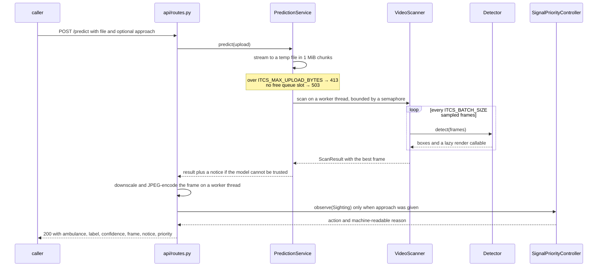
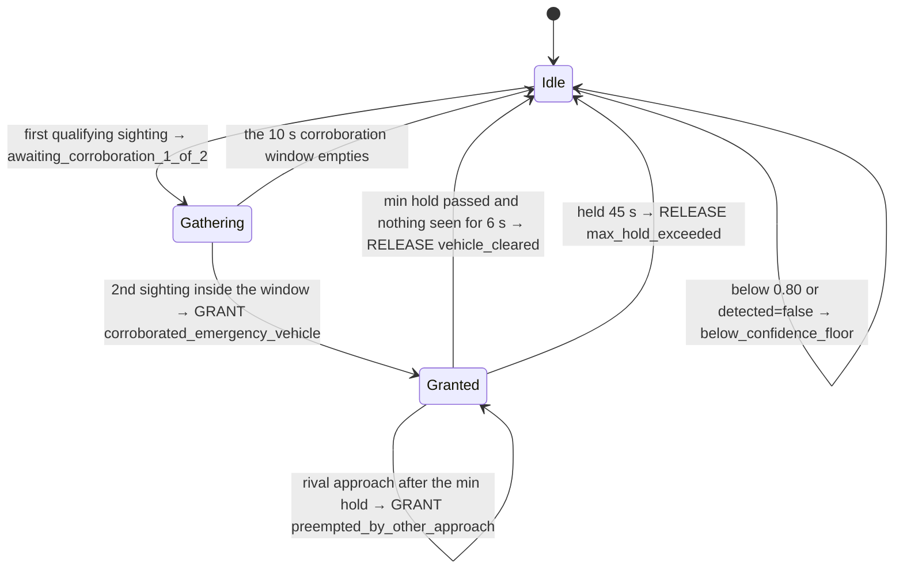

# Intelligent Traffic Control System (ITCS)

A FastAPI service that scans an uploaded traffic clip for an emergency vehicle with a YOLO
model, then feeds the result into a signal-priority **decision layer**: a pure state machine
that says whether an intersection should grant, hold or release an emergency phase.

It emits decisions and nothing else. There is no signal-hardware integration and no user
interface. The HTTP API and its OpenAPI page at `/docs` are the whole surface.

## Quick start

Docker is the one path that needs nothing else installed:

```bash
docker compose up --build -d      # first build downloads torch (CPU) and the YOLO checkpoint
./scripts/demo.sh                 # waits for /health, runs /predict, drives the priority layer
```

The API listens on `http://localhost:8250` (Swagger UI at `/docs`). `scripts/demo.sh` needs
`curl` and `python3` on the host for pretty-printing; `SKIP_COMPOSE=1` points it at a server
you already started, and `BASE=` / `CLIP=` override the URL and the clip.

```console
$ curl -s -F "file=@samples/ambulance.mp4" localhost:8250/predict | jq 'del(.frame, .notice)'
{
  "ambulance": true,
  "confidence": 0.8124947547912598,
  "label": "bus",
  "frames_read": 22,
  "frames_inferred": 8,
  "detector": "coco",
  "priority": null
}
```

Full, unedited transcripts from the compose stack are in
[`docs/predict-session.md`](docs/predict-session.md) and
[`docs/priority-session.md`](docs/priority-session.md); the startup log is
[`docs/service-boot.log`](docs/service-boot.log). Stop the stack with `docker compose down`.

### Without Docker

Python 3.12 (see `.python-version`):

```bash
cd smart-traffic-backend
python -m venv .venv && source .venv/bin/activate
pip install --extra-index-url https://download.pytorch.org/whl/cpu -r requirements-ml.txt
uvicorn app.main:app --port 8250
```

The extra index keeps Linux installs on CPU-only torch wheels; drop it if you have a CUDA GPU.
On a slim Debian or Ubuntu base, OpenCV also needs `libgl1` and `libglib2.0-0` from apt. The
first start downloads `yolov8n.pt` into `smart-traffic-backend/weights/`.

## Model weights

No checkpoint is committed. The `weights/` folder and every `*.pt` file are ignored.

| Detector | Weights | How you get them | Identifies an ambulance? |
| --- | --- | --- | --- |
| `yolo` | `weights/best.pt`, a single-class YOLOv8 model with class `0` = ambulance | Train or supply your own; point `ITCS_WEIGHTS_PATH` at it | yes |
| `coco` | public `yolov8n.pt` (6,549,796 bytes) | Downloaded on first use from the Ultralytics v8.3.0 release assets into `ITCS_MODEL_CACHE_DIR`; the Docker image pre-fetches it at build time | no |
| `stub` | none | Development and tests only (see below) | no, it inspects no pixels |

`ITCS_DETECTOR=auto` (the default) uses `yolo` when `ITCS_WEIGHTS_PATH` exists and `coco`
otherwise. With Docker, mount your own checkpoint over the cache volume:
`-v /path/to/best.pt:/app/weights/best.pt:ro`. Asking for `yolo` without the file stops the
process with a message naming the path and the alternatives.

## Sample clips

`samples/` holds two three-second, 960 px clips (about 0.8 MB each) cut from longer stock
footage: `ambulance.mp4`, an ambulance driving ahead of the camera, and `highway-suv.mp4`,
traffic with no emergency vehicle. The full-resolution originals are not in the repository.
The image ships `samples/` so a fresh container has something to scan.

## Why the fallback answers `"bus"`

COCO has no ambulance class, so the fallback *cannot* identify one, and the service is built
so it cannot pretend otherwise. Each detector carries two capability flags,
`performs_real_detection` and `identifies_ambulances`. `/health` publishes them, and every
`/predict` response from a model that cannot identify an ambulance carries a `notice` saying
so. `ITCS_COCO_EMERGENCY_CLASSES` (`truck,bus`) names the COCO labels treated as *candidate*
emergency vehicles. No accuracy is claimed for that mapping.

## Faking a detection takes two deliberate opt-ins

The `stub` detector returns scripted answers so the HTTP layer can be tested without torch.
`auto` never selects it. It must be named explicitly, *and* `ITCS_ENV` must be `development`
or `test`. `ITCS_ENV` defaults to `production`, where the process refuses to start
(captured in the predict session). When it does run, it logs a `CRITICAL` banner, `/health`
reports `performs_real_detection: false`, and every response carries a fabrication notice.

## What a `/predict` call does



- **The upload never sits in memory.** It is spooled to disk in chunks and refused with 413
  past `ITCS_MAX_UPLOAD_BYTES`. The temp file is removed on every path, including a client
  that disconnects mid-upload.
- **Blocking work stays off the event loop.** The scan (OpenCV decode plus a torch forward
  pass) runs on a worker thread. `ITCS_MAX_CONCURRENT_INFERENCES` caps how many run at once,
  `ITCS_INFERENCE_QUEUE_SLOTS` caps how many may wait, and the surplus gets a fast 503.
- **Sampling, batching and early exit.** `ITCS_FRAME_STRIDE` sends every Nth frame to the
  model, `ITCS_BATCH_SIZE` frames go through in one forward pass, and the scan stops once
  `ITCS_MIN_FRAMES_WITH_AMBULANCE` frames qualify. In the example above, 22 decoded frames
  at stride 3 gave one batch of 8, and that batch was enough. `frames_inferred` counts every
  frame the model saw.
- **Rendering is lazy.** Only the single best frame is annotated.
- **The returned frame is capped.** On a 4096x2160 frame of the source footage, the base64
  JPEG is 1,532,596 characters at OpenCV's default quality 95 with no resize, and 143,232 at
  the shipped defaults (1280 px longest edge, quality 85): 10.7x smaller.
  `ITCS_MAX_FRAME_EDGE`, `ITCS_JPEG_QUALITY` and `ITCS_RETURN_FRAME=false` control it.

## Deciding what a signal should do

`app/priority/` turns noisy sightings into decisions. `SignalPriorityController` is a
deterministic state machine with an injected clock, no I/O and nothing behind it that acts
on its output.



| Rule | Why | Default |
| --- | --- | --- |
| Confidence floor | One confused frame is not evidence | `0.80` |
| Corroboration: N sightings in T seconds | Neither is one confident frame | `2` in `10.0 s` |
| Minimum hold | The phase must not flap | `8.0 s` |
| Preemption only after that hold | A waiting ambulance outranks the tail of a phase | |
| Release once the vehicle has cleared | Give the intersection back | `6.0 s` |
| Hard `max_hold` ceiling | A stuck or spoofed detector cannot hold a junction open forever | `45.0 s` |
| Per-approach cooldown after release | A queue of vehicles must not re-trigger the phase | `20.0 s` |

The `reason` strings are the literal values the API returns. Sightings are always stamped
with the server's clock; a request that tries to supply its own `at` is rejected with 422,
since a far-future timestamp would otherwise keep a phase granted indefinitely.

| Endpoint | Purpose |
| --- | --- |
| `GET /health` | Liveness, version, environment, detector capabilities, free inference slots |
| `POST /predict` | Multipart `file` (a video) and optional `approach`; returns the scan and, with an approach, the priority decision |
| `POST /priority/sightings` | JSON `{"approach", "detected", "confidence"}` from a caller running its own detector |
| `GET /priority/state` | Current phase after applying timeouts, with `cooldown_remaining_s` per approach |
| `POST /priority/tick` | Advance the clock without new evidence, so timeouts fire when no requests arrive |

## Configuration

Every setting is an `ITCS_*` environment variable, read once into a frozen `Settings`
dataclass by `Settings.from_env()`, the only reader of `os.environ` in the code. Invalid
values fail at startup. [`.env.example`](.env.example) lists all of them with their defaults;
`app/config.py` is the source of truth. `docker-compose.yml` overrides a few for a smaller
per-request budget (`ITCS_MAX_FRAMES=60`, `ITCS_FRAME_STRIDE=3`).

## Code layout

```
smart-traffic-backend/app/
  api/         routes, Pydantic schemas, dependency wiring (the only FastAPI code)
  services/    prediction.py: spooling, size cap, thread offload, concurrency limits
  detection/   base.py (Detector protocol), registry.py, yolo.py, stub.py, scanner.py, weights.py
  priority/    controller.py (state machine), models.py (value objects)
  config.py    Settings
  imaging.py   resize, JPEG encode, overlay text
```

Nothing below `api` imports FastAPI, so the scanner and the state machine are tested as
plain objects. Adding a detector backend is one module with a `@register("name")` factory.
`ultralytics` is imported inside the YOLO detector's `warmup()`, so neither the tests nor
the stub path need torch.

## Tests and lint

```bash
cd smart-traffic-backend
pip install -r requirements-dev.txt      # no torch, no weights, no video files
python -m pytest                         # 159 passed
ruff check . && ruff format --check .
```

The suite uses a fake `cv2.VideoCapture` and scripted detectors. An autouse fixture strips
ambient `ITCS_*` variables so a developer's shell cannot steer results.

## Limitations

- **No signal control or hardware integration.** The priority layer emits decisions only.
- **No accuracy figures.** The trained weights are not distributed, and the public fallback
  is not an ambulance classifier.
- **In-memory, single-instance controller.** State is not shared across replicas or kept
  across restarts.
- **Not a stream processor.** One request, one uploaded file, only the frames the budget
  allows. No RTSP ingest and no tracking beyond the sightings you send.
- **Timeouts need driving.** The clock only advances when a request arrives; call
  `/priority/tick` periodically.
- **Uploads are unauthenticated.** They are size- and concurrency-capped, but there is no
  auth and no rate limiting.

## License

MIT, see [LICENSE](LICENSE).
